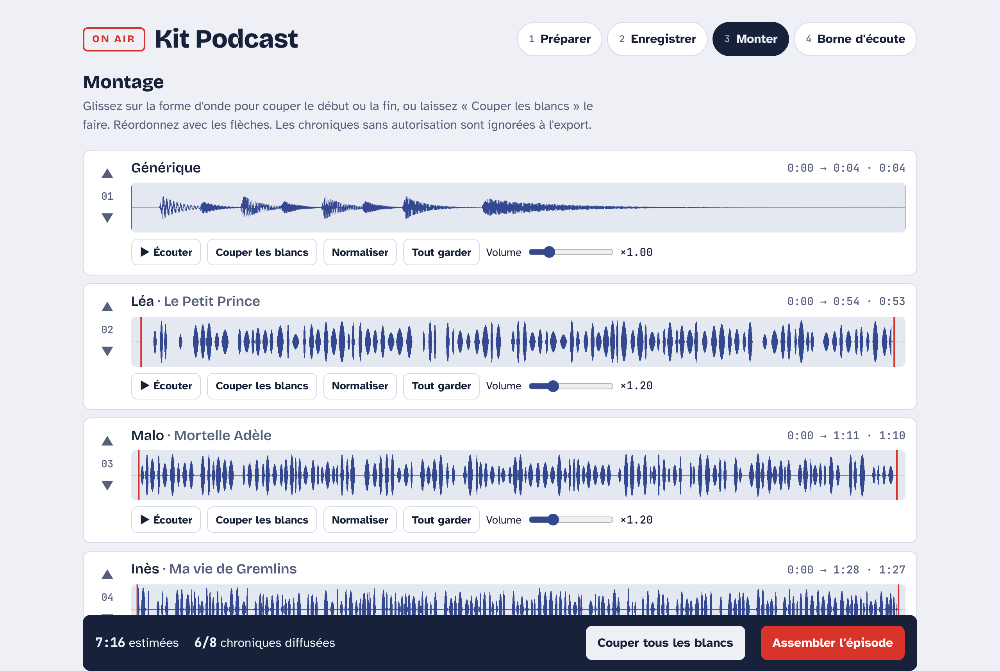
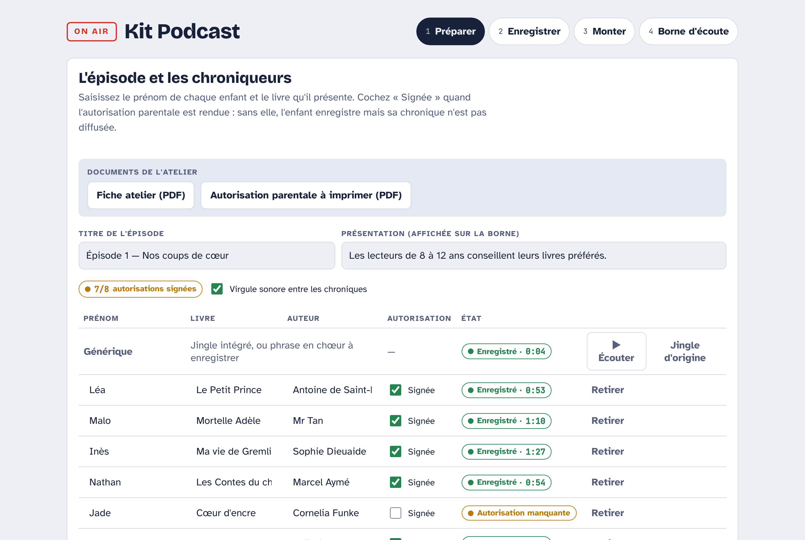
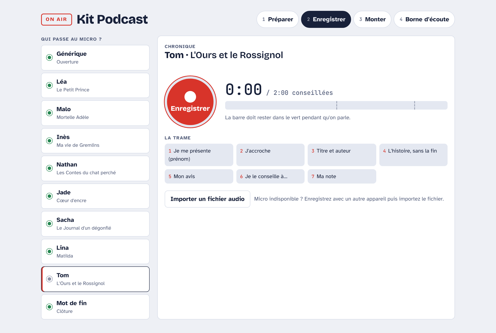
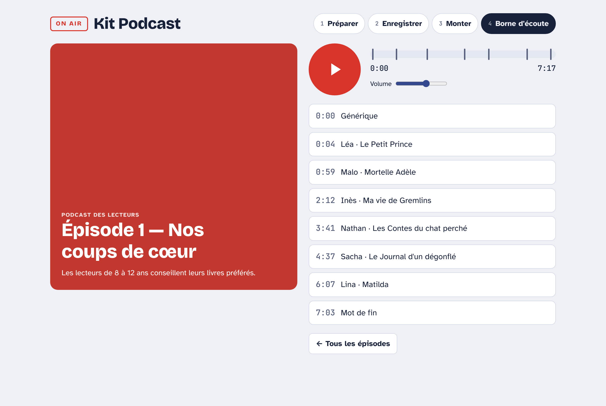

# Kit Podcast

Webapp de biblio.gironde pour animer un atelier podcast jeunesse en bibliothèque : 8 enfants dès 8 ans enregistrent leurs conseils de lecture, la bibliothécaire monte l'épisode, puis le diffuse sur place au casque.




| Préparer | Enregistrer | Borne d'écoute |
| --- | --- | --- |
|  |  |  |

*Captures réalisées avec des prénoms et des enregistrements fictifs.*

## Fonctionnalités

1. **Préparer** : titre de l'épisode, prénoms des chroniqueurs, livres présentés, suivi des autorisations parentales. Accès à la fiche atelier et à l'autorisation parentale en PDF.
2. **Enregistrer** : compte à rebours, vumètre, minuteur (2 min conseillées), garder ou refaire la prise ; import d'un fichier audio si le micro n'est pas disponible.
3. **Monter** : découpe des blancs automatique ou à la main, normalisation du volume, réordonnancement, jingle et virgule sonore intégrés. Les chroniques sans autorisation signée sont exclues de l'export. Export WAV ou paquet `.json` (audio + chapitres) pour une autre borne.
4. **Borne d'écoute** : mode plein écran pour le public, gros boutons, chapitres « Prénom · Livre », volume plafonné, retour à l'accueil après 2 min d'inactivité. Pour quitter : maintenir le logo « On air » 3 secondes.

## Utilisation

Ouvrir `index.html` dans Chrome, Edge ou Firefox, ou via GitHub Pages. Le micro nécessite une page servie en HTTPS (GitHub Pages) ou en local.

Aucune donnée n'est envoyée en ligne : enregistrements et épisodes restent dans le navigateur du poste (IndexedDB). Sauvegarder les exports WAV sur le serveur de la bibliothèque avant de vider le navigateur.

## Documents

- [Fiche atelier](docs/fiche-atelier.pdf) (1h30, 8 enfants, 1 bibliothécaire)
- [Autorisation parentale d'enregistrement et de diffusion](docs/autorisation-parentale.pdf), à faire valider par le service juridique ou le DPO de la collectivité

## Application ordinateur (Electron)

Les versions macOS (`.dmg` universel), Windows (installateur et version portable) et Linux (`AppImage`, `.deb`) sont publiées dans les [Releases](https://github.com/biblioGironde/Kit-Podcast/releases). L'application donne accès au micro sans réglage et ouvre les PDF dans le lecteur du système.

Les applications ne sont pas signées : au premier lancement, macOS demande d'ouvrir via clic droit → Ouvrir, et Windows SmartScreen via « Informations complémentaires » → « Exécuter quand même ».

### Développement

```bash
npm install
npm start          # lancer l'application
npm run dist       # construire pour le système courant
```

### Publier une nouvelle version

Mettre à jour `version` dans `package.json`, puis pousser un tag :

```bash
git tag v1.0.0 && git push origin v1.0.0
```

Le workflow GitHub Actions construit les trois plateformes et les attache à la release.
